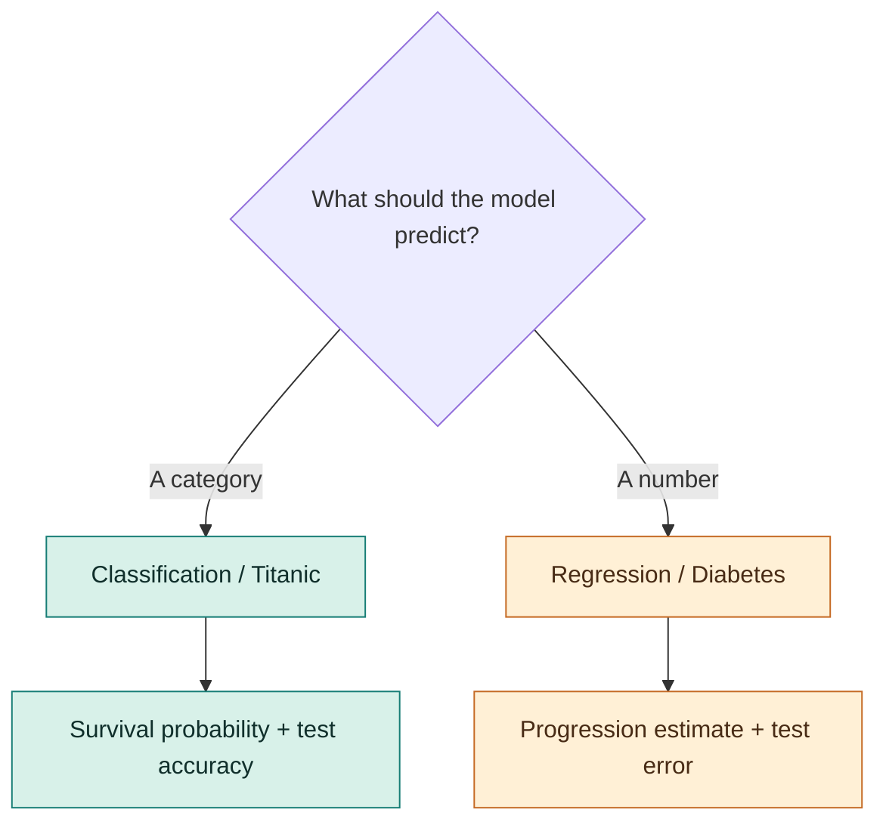

<p align="center">
  <a href="https://github.com/bhandkunal02-eng/Decision_tree_Classifier_and_Regressor">
    
  </a>
</p>

<h1 align="center">Decision Tree Lab</h1>

<p align="center"><strong>Two datasets. Two prediction problems. Follow each split to its leaf.</strong></p>

<p align="center">
  A hands-on machine-learning playground for seeing how decision trees classify and predict.
</p>

<p align="center">
  <a href="https://decision-tree-lab.streamlit.app/">
    
  </a>
  <a href="https://github.com/bhandkunal02-eng/Decision_tree_Classifier_and_Regressor">
    
  </a>
  
</p>

## Pick a path

| 01 / Classification | 02 / Regression |
|:--|:--|
| **Titanic: who survives?** | **Diabetes: what is the progression score?** |
| Adjust tree depth and minimum split size. Try a passenger profile and inspect test accuracy, a confusion matrix, and the tree. | Tune tree depth and edit all ten input features. Compare test error and R², explore predictions, and inspect the tree. |
| [Open the classification notebook](Dicision_tree_classification.ipynb) | [Open the regression notebook](Dicision_tree_regression.ipynb) |

## One tree, two outcomes



## What you can explore

- **Classification:** A decision tree learns from passenger class, sex, fare, embarkation port, and age. The app imputes missing values and encodes categories in a preprocessing pipeline.
- **Regression:** A decision tree learns from ten diabetes dataset features. Adjust depth and a feature profile to see how the prediction and test metrics respond.
- **In both tabs:** Change model settings, inspect a tree visualization, and compare predictions against held-out test data.

## Launch locally

```bash
git clone https://github.com/bhandkunal02-eng/Decision_tree_Classifier_and_Regressor.git
cd Decision_tree_Classifier_and_Regressor
python -m venv .venv
```

Activate the environment, then install and run the app:

```bash
# Windows PowerShell
.venv\Scripts\Activate.ps1
# macOS / Linux
source .venv/bin/activate

python -m pip install -r requirements.txt
streamlit run app.py
```

Both datasets may need internet access on their first load. The app is deployed from `main`; new commits to that branch are deployed automatically.

## Project files

```text
app.py                              Interactive Streamlit app
Dicision_tree_classification.ipynb  Classification lesson
Dicision_tree_regression.ipynb      Regression lesson
requirements.txt                    App dependencies
```

<p align="center"><sub>Built to make every branch of the model easier to follow.</sub></p>